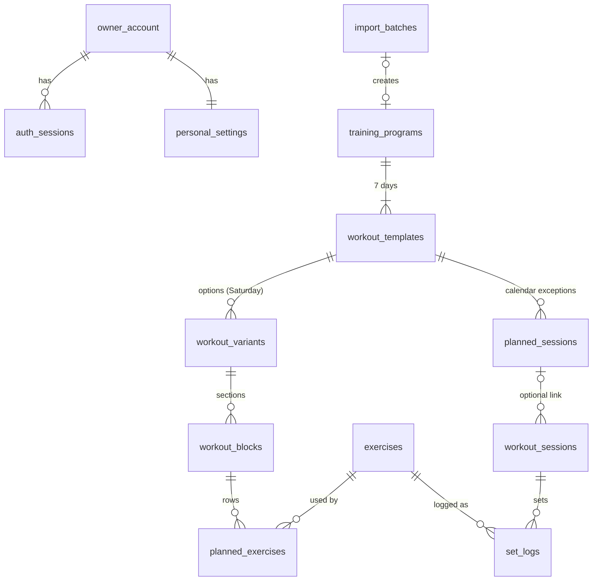
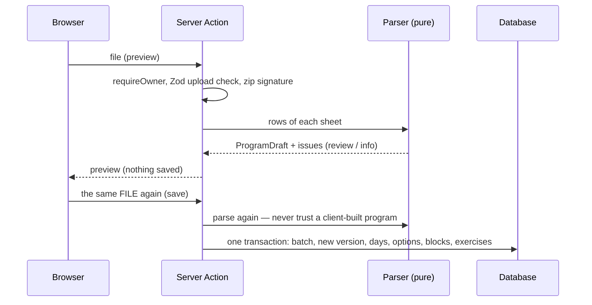

# Architecture

## Layers

| Layer | Folder | Rule |
| --- | --- | --- |
| Routes | `src/app` | Pages (Server Components) read data; Server Actions mutate. Both call `requireOwner()` first. No business rule here. |
| Business logic | `src/features/*` | Plain functions taking `db` as a parameter. Testable without a browser or HTTP. |
| Data | `src/db` | Drizzle schema, lazy client (`getDb()`), shared `Db` type for postgres-js and PGlite. |
| UI | `src/components` | Client or server components fed by props. Formatting helpers come from `features/*/format`. |
| Helpers | `src/lib` | Auth cookie & current owner, time-zone dates, kg/lb units. |

## Data model

`login_attempts` (hashed client key, rate limiting) stands alone.

### Integrity enforced by PostgreSQL

| Rule | Mechanism |
| --- | --- |
| One owner | `singleton boolean unique` + `check (singleton = true)` |
| One active program | partial unique index on `is_active` where true |
| One active workout | generated column `is_active` + partial unique index |
| Same file never imported twice | `import_batches.file_sha256 unique` |
| A double tap creates one workout | `workout_sessions.idempotency_key unique` |
| One row per set | unique `(session_id, snapshot_key, set_number)` + upsert |
| One calendar exception per day | unique `planned_sessions.date` |
| Sane values | checks on weekday, set ranges, rep order, non-negative weights/reps/durations, end ≥ start |

## Key flows

### Excel import

The parser never guesses: an unreadable cell keeps its text and is flagged `needsReview`; the editor clears the flag once corrected.

### A workout

1. **Start** — the schedule resolves what today holds (moves, Saturday option); the plan is copied into `workout_sessions.plan_snapshot`. Editing the program later never touches it.
2. **Log** — the client queues each set (`localStorage` mirror), sends them in order to `saveSetAction`; the server validates against the snapshot and upserts. Network errors keep the item and retry; a reload replays the queue.
3. **Finish** — waits for in-flight saves, then an idempotent update; the summary compares with past bests (a first attempt is not a record).

### Time zones

Instants are stored as `timestamptz` (UTC). "Today", the week strip, the calendar and consistency use the owner's time zone (`personal_settings.timezone`). Calendar dates are `date` / `YYYY-MM-DD` strings — no hidden offsets. Tested around midnight and daylight-saving changes.

## Security

- **Authentication**: argon2id hashes; 256-bit random token in an `httpOnly`, `SameSite=Lax`, `Secure` (production) cookie; only its SHA-256 is stored; 30-day expiry checked against the database clock; constant-time answer for unknown emails; 5 failures / 15 min per hashed client key.
- **Authorization**: `proxy.ts` only redirects page navigations without a cookie (fast path). The real check is `requireOwner()` in the private layout, in **every** Server Action (they are public HTTP endpoints) and in API routes (401).
- **Input**: Zod on every action; uploads limited by size, extension, MIME type and zip signature; files parsed in memory, never written.
- **Headers**: CSP, `frame-ancestors 'none'`, `X-Frame-Options`, `nosniff`, referrer and permissions policies, HSTS, `noindex`.
- **Secrets**: only `DATABASE_URL`, read on the server at first use; nothing secret in client bundles.

## Testing strategy

| Level | Tool | Database | What |
| --- | --- | --- | --- |
| Unit | Vitest | none | parsers, formatters, dates, units |
| Integration | Vitest | PGlite with the real migrations | every feature function, constraints, rollbacks |
| End-to-end | Playwright | PostgreSQL (CI service) | journeys on a production build, security, axe accessibility in light and dark |
